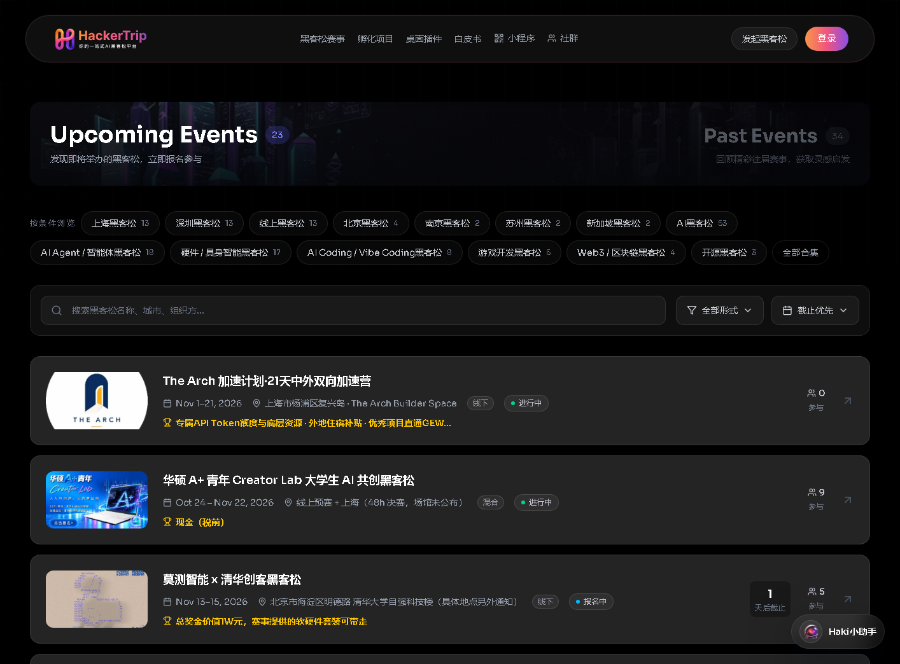
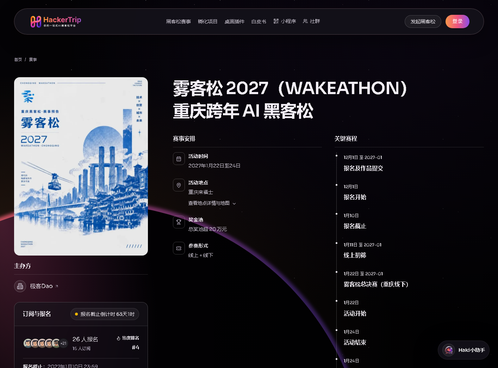
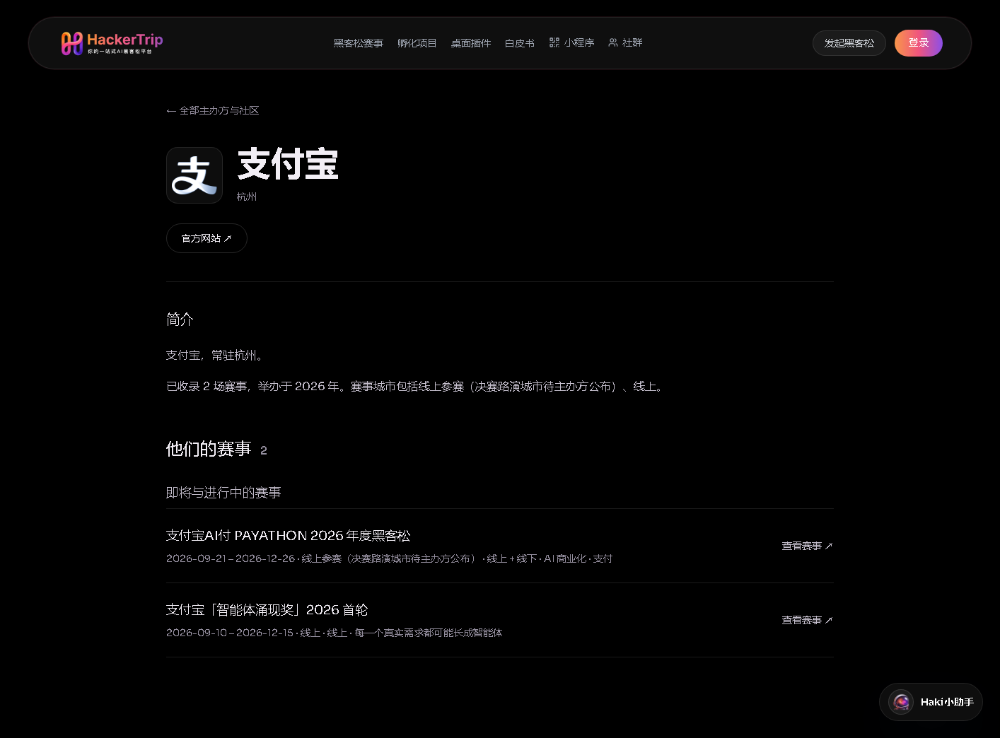

# 对标研究：HackerTrip（hackertrip.space）

> 研究时间：2026-11-08 · 对象：<https://hackertrip.space/>（中国镜像 <https://hackertrip.cn/>）
> 方法：逐页阅读 + 抓取公开 API / sitemap / llms.txt / agent.json + 1440px 与 390px 真机视口截图 + 对 57 条公开赛事做字段统计。
> 说明：本文只基于公开可访问信息，不推断对方流量、营收、团队规模；所有数字都是 2026-11-08 的快照。

---

## 0. 一句话结论

HackerTrip 不是「又一个赛事列表」，而是 **「发现赛事 → AI 匹配 → 参赛工具 → 主办方增长」的四层产品**。

它最值得我们抄的不是视觉，而是这四件事：

1. **把赛事做成可筛选、可比较的结构化数据**，而不是一条条链接；
2. **给主办方建实体页**，让「人/组织」成为可索引、可信任的入口；
3. **把信任边界写清楚**：自动采集不等于事实，页面更新时间不等于主办方公告时间；
4. **把 Agent 当成一等用户**：llms.txt / llms-full.txt / agent.json / Markdown API / JSON-LD 一整套。

最不该抄的也很明确：**泛赛道、账号体系、组队/作品/身份卡/小程序/桌面端的功能堆叠，以及「看起来热闹但数据是空的」社交证明**。

---

## 1. 它到底是什么

### 1.1 定位

> 「你的一站式黑客松 AI 平台」——聚合 AI、Web3、开源与硬件赛事。
> 输入项目方向，帮你看赛道、截止时间、奖金池和报名路径。

它不是只做 AI：57 条赛事里 AI 相关约 53 条，另有 Web3、硬件、开源、游戏等；覆盖中国 + 新加坡/美国/台湾/香港。

### 1.2 产品形态

| 形态 | 入口 | 作用 |
|---|---|---|
| 网页 | `/`、`/explore`、`/hackathon/<slug>`、`/organizers/<slug>` | 发现、筛选、比较、报名跳转 |
| 微信小程序 | 首页二维码 | 移动端发现 / 报名 / 身份卡 / 作品 |
| Haki Desktop | `/haki-desktop` | macOS 桌面助手：AI CLI 监控、倒计时、赛事文档问答、提交清单、Git 记录 |
| CLI + Skills | `/cli`、`npx hackertrip` | 选手扫项目找比赛/发作品；主办方提交赛事/跟踪审核 |
| 白皮书 | `/whitepaper` | 主办方增长与合作的 B2B 销售页 |
| 内容 | `/guides/*`、`/docs`、FAQ | SEO / AI 搜索 / 新手教育 |

### 1.3 页面地图（从 sitemap 统计）

141 个 URL：

- 78 个 `/hackathon/*`
- 43 个 `/organizers/*`
- 3 个 `/guides/*`
- 以及 `/explore`、`/works`、`/vibecard`、`/identity`、`/launch`、`/hacks`、`/docs`、`/cli`、`/arsenal`、`/haki-desktop`、`/whitepaper`、`/about`、`/contact`、`/methodology`、`/privacy`、`/terms`

对比我们：72 个 URL（3 个静态页 + 69 个详情页）。**差距不在赛事页，而在「人/组织/内容」页。**

---

## 2. 它做得好的地方（有证据）

### 2.1 Explore：真正的「可筛选」

- 顶部两个 Tab：**Upcoming 23 / Past 34**；
- 15 个筛选 chip，每个带数量：上海 13、深圳 13、线上 13、北京 4、AI 53、AI Agent 18、硬件/具身 17、AI Coding 8、游戏 5、Web3 4、开源 3；
- 搜索框 + 形式 + 排序（截止优先）；
- 卡片包含：封面图、标题、日期、地点、线上/线下、进行中/报名中、奖金、**参与人数**、截止倒计时。

它的筛选不是「装饰」：数量、状态、排序都和列表联动。

### 2.2 赛事详情：把「报名决策」所需信息一次给全

- 左侧海报/封面，右侧标题；
- 关键事实卡：活动时间、地点、奖金池、参赛形式；
- 主办方实体链接；
- **订阅与报名卡**：倒计时、报名人数、订阅人数、热度排名、订阅按钮、官方报名按钮；
- 关键日程时间线（报名开始/截止/初筛/决赛/颁奖）；
- 赛道、奖励说明、完整活动详情；
- 其他赛事推荐；
- 「信息来源与更正」免责声明。

公开 API 显示详情字段很全：57/57 有 summary、agenda、venue、location；54/57 有 cover、deadline、tracks；50/57 有 prize。

### 2.3 主办方实体页：42 个可索引的「人」

每个主办方有：logo、城市、官网、简介、自动生成的「已收录 N 场赛事」摘要、赛事列表、`Organization` JSON-LD。

这是它 SEO 和信任的关键：用户搜「支付宝 黑客松」能落到一个实体页，而不是一条赛事详情。

### 2.4 信任边界写得非常清楚

`/methodology` 原文要点（转述）：

- 来源：主办方官网、官方报名页、公开活动页、主办方直接提交；
- 核对：按来源一致性、信息完整度、更新时间；自动采集不等于事实；冲突时主办方最新公告优先；
- **页面更新时间表示 HackerTrip 内容更新，不代表主办方公告时间**；
- AI 匹配只比较技术栈/项目方向与主题/赛道/标签，是缩小检索范围的工具，不保证录取/获奖；
- 引用：平台功能/方法可引；具体赛事日期、奖金、资格、报名状态应优先引主办方官方页；
- 更正：提供页面 URL + 官方来源 + 明确字段，团队核对后更新。

这比「我们全部核验过」更成熟：**它没有把「链接能打开」偷换成「赛事信息为真」**。

### 2.5 Agent / AI 搜索入口是一整套

| 入口 | 内容 |
|---|---|
| `/llms.txt` | 产品定义、中文摘要、页面、能力、引用边界 |
| `/llms-full.txt` | 更完整的 AI reference（约 11KB） |
| `/.well-known/agent.json` | A2A 能力清单：team_search、hackathon_search、agent_discovery、negotiate_teamup、project_showcase；标注哪些端点需要登录 |
| `/api/match` | JSON，`limit=1..100`，只返回 upcoming/ongoing |
| `/api/match?format=markdown` | 给 LLM 的 Markdown 列表，带「请核对主办方」提醒 |
| JSON-LD | 全站 Organization/WebSite/SoftwareApplication 图；Explore 的 ItemList；赛事的 Event；主办方的 Organization |

它的 Event JSON-LD 包含 `award`、`offers.validThrough`、`keywords`、`sponsor`、`sameAs`，比我们现在的 Event 结构更完整。

### 2.6 内容 / SEO / 分发

- `/guides/2026-ai-hackathon-guide`：回答「2026 AI 黑客松怎么找」，带结论、赛事表、判断标准、FAQ、来源；
- 首页 FAQ 8 个问题（是什么、怎么找、来源、主办方提交、2026 有哪些、第一次准备、线上 vs 线下、作品展示）；
- 小红书、公众号、微信群、小程序、Newsletter（每周推送）；
- `.cn` / `.space` 双域 + hreflang；
- 主办方白皮书（B2B）；
- 141 个 sitemap URL + 结构化数据 + llms.txt。

### 2.7 视觉与社交证明

- 深色太空/像素风，强品牌感；
- 封面图 54/57，卡片比纯文字列表更有「活动感」；
- 参与人数、订阅人数、热度排名、精选徽章；
- 主办方 logo 墙、社区二维码、Haki 像素小人。

这些是「让人想点」的设计，但也很容易变成噪音。

---

## 3. 数据快照与质量（硬指标）

### 3.1 它的数据

| 指标 | 数值 |
|---|---|
| `/api/hackathons` 总数 | 57 |
| 状态 | closed 32 / live 16 / upcoming 9 |
| `/api/match` 在架 | 25（upcoming + ongoing） |
| 形式 | offline 30 / hybrid 21 / online 6 |
| 城市 | 15+；上海 13、深圳 13、线上 6、北京 4 |
| 主办方 | 42（页面）；sitemap 43 个 organizer URL |
| cover / prize / deadline / tracks / agenda / summary | 54 / 50 / 54 / 54 / 57 / 57（共 57） |
| techStack / tags | **0 / 0**（API 字段为空，尽管页面有技术栈筛选） |
| registration mode | external-form 45 / wechat-qr 4 / platform 4 / 空 4 |
| isVerified | **false 57/57** |
| isFeatured / isLive | 1 / 0 |
| seriesName / editionNumber / infoCards | 0 / 0 / 0 |
| participantCount > 0 | 51/57（多为个位数到 26） |
| sitemap | 141 URL（78 赛事 / 43 主办方 / 3 指南） |

### 3.2 它暴露出的「数据债」

- sitemap 有 78 个赛事页，API 只有 57 条 → 可能有过期/重复/未发布 slug；
- `llms.txt` 写「Last updated: 2026-08-29」，但站点/赛事更新到 11 月 → AI 文档过期；
- `llms.txt` 给的 GitHub 仓库链接 404（`Jayden72Huang/hacker_trip`）；
- 主办方列表里有一条 **「HackerTrip 流程验收测试主办方（勿公开）」**，测试数据进了生产；
- `/works` 公开页是空状态「暂时还没有作品」；
- 技术栈筛选存在，但 57 条 API 数据的 `techStack`/`tags` 全空。

这些不是要嘲笑对方，而是提醒：**功能可以先上，但数据/文档/测试数据必须同步治理**。

### 3.3 我们 vs 它

> 下表「我们」列是研究时快照（78 条 / 45 首页 / 69 详情 / 42 个主办方、0 个实体页）。
> 截至 2026-11-08 23:26 已变为 77 / 44 / 68、36 个实体页；落地明细见第 8 节。

| 维度 | HackerTrip | 我们（AI 赛事雷达） |
|---|---|---|
| 范围 | AI/Web3/开源/硬件，57 条 | **只收 AI**，78 条 |
| 在架 | 25 upcoming/ongoing | 首页 45 场（在架 + 近 14 天结束） |
| 链接验证 | `isVerified=false`，靠来源链接 + 免责声明 | **78/78 HTTP 200**，另有 evidence 字段（22/78） |
| 详情丰富度 | 封面、agenda、完整 summary、tracks、主办方 | KV + 核验侧栏，缺 summary/agenda/封面 |
| 主办方页 | 42 个，有 logo/简介/官网 | 42 个主办方，**0 个实体页** |
| 筛选 | 城市/主题/技术栈/形式/状态，带数量 | 搜索 + 形式/状态 + 截止排序，无城市/主题 facet |
| 日历 | **未发现公开 ICS/RSS**（`/calendar.ics`、`/feed.xml` 等常见路径 404） | **有** `/calendar.ics`、单场 `.ics`、`webcal://`、RSS |
| 邮件 | 每周 Newsletter + 公众号/小红书/群 | 每日摘要，附 `.ics`，但无订阅者/表单 |
| Agent | llms/full、agent.json、Markdown API、CLI/Skills | JSON/RSS/llms、JSON-LD Event，无 agent.json/Markdown/CLI |
| 内容 | 3 篇指南 + FAQ + 方法论 + 白皮书 | about/submit，无指南/FAQ |
| 视觉 | 深色太空、封面卡片、社交证明 | 浅色纸面、发丝线清单、雷达 |
| 主战场 | 线下/混合 + 主办方增长 | **线上 AI 赛**（57/78 线上） |

**关键洞察：我们不应该变成 HackerTrip。** 它的广度和参与层很强，但它的「验证」是弱的；我们的「78/78 活链 + AI-only + 每天 08:00」是更硬的承诺。正确姿势是：**借它的信息架构和 AI 入口，强化我们的「可验证」定位。**

---

## 4. 值得借鉴的 8 件事（按优先级）

### P0-1. 主办方实体页（最值得抄）

**它有什么**：42 个 `/organizers/<slug>`，logo、城市、官网、简介、自动摘要、赛事列表、Organization JSON-LD。

**我们怎么改**：

- 我们的数据：42 个主办方，7 个有 ≥2 场（中国农业大学 5、科大讯飞 4、中国电子学会&睿创微纳 4、声网 2、支付宝 2、华为 2、光年AI 2）；
- 先做 **Top 10 主办方页** + 一个 `/organizers.html` 索引；不要给只有 1 场、没有简介的主办方批量生成薄页；
- 数据文件 `data/organizers.yaml`：`slug`、`name`、`aliases`、`city`、`website`、`logo`、`intro`；没有 logo 就用字母/雷达点做占位；
- `build_site.py` 生成 `organizer/<slug>.html`，详情页的主办方名变成链接；
- 加 `Organization` JSON-LD、`ItemList`、sitemap；
- 自动摘要模板：「已收录 N 场 AI 赛事，覆盖线上/线下，最近一场截止 …」。

**工作量**：1–2 天；**收益**：SEO 长尾 + 信任 + 导航，最高性价比。

### P0-2. 真正的 Explore：用我们自己的 facet

**它有什么**：Upcoming/Past Tab + 15 个带数量的 chip + 搜索 + 排序 + 卡片。

**我们怎么改**：

- **不要照抄城市 facet**：我们的线下城市只有 9 个，多数 1 场（深圳 2，上海/北京/杭州/三亚/福州/太原等 1）；城市 chip 会很空；
- 用我们的优势做 facet：
  - **AI 方向**：大模型 / 智能体 / 具身 / 算法 / AIGC / 数据 / 算力 / 多模态…
  - **平台**：天池 / 讯飞 / DataFountain / AI Studio / DoraHacks / 活动行 / Luma / 知乎 / 和鲸
  - **AI 级别**：core / platform / track / other
  - **形式**：线上 / 线下 / 混合
  - **状态**：报名中 / 即将截止 / 即将开始 / 已截止
- 每个 chip 显示数量；加 Upcoming/Past Tab；URL 带 `?theme=agent&mode=online&status=open`，可分享；
- 单独 `/explore.html`，首页保持编辑精选；或首页列表直接升级。

**工作量**：1–2 天；**收益**：把 78 条数据变成「可逛」的产品，而不是一条长清单。

### P0-3. 信任语言：把「链接 200」和「内容为真」分开

**它有什么**：方法论页、来源/更新时间/引用边界、更正入口、`isVerified=false`。

**我们怎么改**：

- 现在的「已确认可打开」容易被读成「赛事信息已核实」；
- 改成三层：
  - **链接核验**：HTTP 200 / 核验时间；
  - **内容来源**：官方页 / 官方公众号 / 人工种子；
  - **信息状态**：报名截止「待确认」、报名已关闭、已结束归档；
- 详情页侧栏显示：`链接核验于 2026-11-08 20:54`、`页面更新于 2026-11-08`、`来源页`、`纠错`;
- 加一句：「页面更新时间为本站构建时间，不代表主办方公告时间；报名/奖金以官方页为准」；
- 加 FAQ：「为什么有的截止日显示待确认？」「为什么只有 78 条？」「已结束的赛事保留多久？」「数据可以转载吗？」
- 给 Event JSON-LD 加 `dateModified`。

**工作量**：0.5–1 天；**收益**：把我们真正的差异点讲清楚，避免「像 HackerTrip 一样只做免责声明」。

### P0-4. Agent/LLM 入口补齐（便宜且高杠杆）

**它有什么**：`llms.txt` + `llms-full.txt` + `agent.json` + Markdown API + JSON-LD 图 + CLI/Skills。

**我们怎么改**（都能静态生成）：

- `site/llms-full.txt`：完整版（数据字段、核验规则、引用边界、更新语义、示例）；
- `site/.well-known/agent.json`：只读能力清单：
  - `hackathon_search` → `/api/events.json`
  - `calendar_subscribe` → `/calendar.ics`
  - `rss` → `/feed.xml`
  - `authentication: none`
- `site/api/events.md`：和 `api/events.json` 同源的 Markdown 列表（给 LLM 省 token）；
- 全站 JSON-LD graph：`Organization` + `WebSite`（+ `SearchAction` 如果有搜索 URL）；
- 首页/Explore 加 `ItemList`；
- Event JSON-LD 增加 `award`（奖金）、`offers.validThrough`（截止日）、`keywords`（赛道）、`sameAs`（source_url）；
- `<link rel="alternate" type="text/plain" href="/llms.txt">`、`application/rss+xml`、`text/calendar`。

**工作量**：1–2 天；**收益**：AI 搜索/Agent 更容易发现和引用我们，直接对应你上次问的「接入 agent」。

### P1-1. 赛事详情补三块：摘要、日程、主办方卡

**它有什么**：57/57 有 summary（中位 497 字）、57/57 有 agenda（中位 5 个节点）、主办方实体卡、其他赛事推荐、来源/更正。

**我们怎么改**：

- 给 `races.json` 增加 `summary`（官方 meta description / 报名页简介，必须可溯源）；
- 从 `start_date`、`deadline`、`end_date` 生成 3–5 个日程节点（报名开始/截止、比赛开始/结束），没有的就不编；
- 详情页加「主办方」卡（链接到实体页）、「同主办方/同赛道」推荐 3 条；
- 加「信息来源与更正」块：`source_url` + 纠错入口 + `id`；
- 不做假的报名人数/热度。

**工作量**：2–3 天 + 数据补全；**收益**：详情页从「信息卡」变成「决策页」。

### P1-2. 指南 + FAQ：回答「怎么找/怎么选/怎么报」

**它有什么**：`/guides/2026-ai-hackathon-guide`、首页 8 个 FAQ、FAQ 结构化数据、AI 搜索导向的写法。

**我们怎么改**：

- 3 篇数据驱动的指南：
  1. 「2026 AI 赛事日历：现在还能报名的都在这里」（每月更新，链到在架列表）；
  2. 「第一次参加 AI 黑客松：从报名到提交」（流程、材料、常见坑）；
  3. 「线上 vs 线下 AI 赛事：怎么选」（用我们的 57 线上 / 10 线下 / 4 混合数据）；
- FAQ 6–8 条 + `FAQPage` JSON-LD；
- 页脚/关于页链接；每篇都写「以主办方官方页为准」；
- 不要写泛泛的 AI 生成内容；每篇至少引用 3 条本站数据。

**工作量**：2–3 天；**收益**：SEO/AI 搜索长尾，建立「懂行」的品牌。

### P1-3. AI 匹配：我们的版本可以更轻

**它有什么**：输入项目方向/技术栈 → 候选赛事 + 匹配理由；CLI 扫本地项目；Haki 助手。

**我们怎么改**：

- 静态页 `match.html`：用户选「方向（智能体/具身/算法/…）+ 形式 + 城市 + 截止窗口」；
- JS 对 78 条数据做加权：标题/赛道/tracks/notes 命中 + 形式/城市/截止加权；
- 输出 Top 10 + 命中理由（「命中 智能体 + 线上 + 11-15 截止」）；
- 不做账号、不上传代码、不编「匹配分」；明确「这是筛选器，不是录取预测」。

**工作量**：1–2 天；**收益**：把「AI 赛事雷达」从列表变成「帮我选」；但注意我们的 `techStack/tags` 数据还不如 HackerTrip 完整，先把 tracks/notes 质量做好。

### P1-4. 往届归档 + Newsletter 存档

**它有什么**：Past 34 Tab；每周 Newsletter；公众号/小红书。

**我们怎么改**：

- `/archive.html`：33 条已结束（>14 天、≤90 天）赛事，按截止日倒序；加 `ItemList`；
- Newsletter 存档页：把每期摘要变成可索引页面（可选）；
- 订阅入口用 `SUBSCRIBE_URL` / `SUBSCRIBE_EMAIL`（我们已有钩子），先做「每周一封」而不是每天，降低打扰。

**工作量**：1 天；**收益**：长尾 SEO + 留存。

### P2：可选，不要现在做

- **封面/OG 图**：HackerTrip 54/57 有封面；我们可以用 CSS/SVG 生成「雷达风」标题卡，作为 `og:image` 和详情页头图，不依赖外部图片；
- **系列/赛季**：天池/讯飞的赛季、客松系列；需要 `series` 字段和人工维护；
- **主办方入驻页**：`/organize.html` + 纠错/认领，学习它的白皮书，但不要做数据看板；
- **城市/主题 hub**：只做「线上 AI 赛事」和 ≥5 场的方向 hub，不做 9 个 1 场的城市页；
- **CLI/Skill**：给 Agent 一个只读 Python CLI（读 `api/events.json`，输出 Markdown/ICS），比做桌面端便宜。

---

## 5. 不要照搬的 7 件事

1. **泛赛道**：它覆盖 Web3/硬件/开源/加速营；我们只做 AI。扩到泛赛道会稀释「AI 赛事雷达」的定位，也会把核验成本推高。
2. **把微信二维码/私域报名当公开赛事**：它有 4 条 `wechat-qr`、45 条 external-form；我们的红线是「公开官方链接实测 200」，私域只能进 leads。
3. **弱验证 + 强免责声明**：它 57/57 `isVerified=false`；我们的 78/78 活链是差异点，不能退回「只做免责声明」。
4. **假/弱社交证明**：participantCount/热度排名是站内数据；我们没有真实报名数据，就不要造「N 人报名」「热度 #4」。
5. **功能堆叠**：works/identity/ViberCard/launch/arsenal/小程序/桌面端——它的 `/works` 还是空的。静态站 + 一个人，守不住这么多面。
6. **深色游戏化视觉**：太空/像素/大渐变很抓眼，但用户刚说「有点暗」；我们的纸白 + 雷达 + 宋体是更合适的差异。
7. **测试数据/过期 AI 文档/孤儿页**：它的测试主办方公开可见、llms 停留在 8 月、sitemap 78 vs API 57、GitHub 404。我们的 sitemap 72 = 3 静态 + 69 详情，干净；继续保持。

---

## 6. 如果只做三件事

1. **主办方实体页（Top 10 + 索引）**——最高 SEO/信任性价比；
2. **信任语言 + FAQ**——把「78/78 活链」讲成「链接可打开 ≠ 内容为真」，反而更可信；
3. **Agent 入口四件套**（`agent.json` / `llms-full.txt` / `api/events.md` / JSON-LD graph）——便宜、差异化、直接回应「agent 接入」。

这三件事都不需要账号体系、后端或新数据源，适合我们现在的静态站。

---

## 7. 证据与复现

### 7.1 关键 URL

- 首页：<https://hackertrip.space/>
- Explore：<https://hackertrip.space/explore>
- 赛事详情：<https://hackertrip.space/hackathon/mp-ht-2027>
- 主办方页：<https://hackertrip.space/organizers/alipay-4b09ba46e0>
- 方法论：<https://hackertrip.space/methodology>
- 白皮书：<https://hackertrip.space/whitepaper>
- AI 指南：<https://hackertrip.space/guides/2026-ai-hackathon-guide>
- CLI：<https://hackertrip.space/cli>
- `llms.txt`：<https://hackertrip.space/llms.txt>
- `llms-full.txt`：<https://hackertrip.space/llms-full.txt>
- Agent manifest：<https://hackertrip.space/.well-known/agent.json>
- API：<https://hackertrip.space/api/match?limit=3>、<https://hackertrip.space/api/hackathons?limit=3>
- Sitemap：<https://hackertrip.space/sitemap.xml>

### 7.2 本地证据

- `research/match.json`：`/api/match?limit=100`（25 条）
- `research/hackathons.json`：`/api/hackathons?limit=100`（57 条）
- `research/sitemap.xml`、`llms.txt`、`llms-full.txt`、`agent.json`
- `research/pages/*.txt`：渲染后的页面文本
- 截图：`docs/img/benchmark/`（首页、Explore、详情、主办方、主办方列表、空作品页、白皮书、移动端）

### 7.3 研究边界

- 未登录，未进入小程序/桌面端内部；小程序/Haki 的能力来自公开页面与 llms.txt；
- 未测量流量、留存、营收、合作方数量；
- 未发现公开 ICS/RSS（常见路径 404），不排除有需登录/未公开的日历能力；
- 数据为 2026-11-08 快照，赛事状态会变；
- 对方的 `isVerified:false` 是公开字段，不代表其内部没有人工核对；本文只评价公开信号。

---

## 8. 落地状态（2026-11-08）

本报告中的 P0/P1 项已在本仓库落地：

| 借鉴项 | 落地 | 入口 |
|---|---|---|
| 主办方实体页 | 35 个可见主办方页 + 索引；Top 10 有 `data/organizers.yaml` 的 slug/官网/简介 | `/organizers.html`、`/organizer/<slug>.html` |
| Explore 多面筛选 | 方向/平台/AI 级别/形式/状态 + 往届 Tab + URL 参数 + 动态数量 | `/explore.html` |
| 信任语言 | 链接核验 vs 内容核实、页面更新 vs 主办方公告、来源块、8 条 FAQ、FAQPage | `/about.html#faq`、详情页「信息来源与更正」 |
| Agent/LLM 入口 | `llms-full.txt`、`agent.json` + `.well-known/agent.json`、`api/events.md`、全站 JSON-LD graph、ItemList、Event 增强 | `/llms-full.txt`、`/agent.json`、`/api/events.md` |
| 详情增强 | 官方页 meta 简介（过滤平台描述；无独立简介时用已核验字段摘要）、日程、主办方卡、相关赛事、纠错预填、`dateModified` | `/race/<id>.html` |
| 指南 | 3 篇数据驱动指南 + 指南索引 | `/guides.html` |
| AI 匹配 | 浏览器本地加权匹配 + 命中理由，不上传数据 | `/match.html` |
| 往届 | Explore 的「往届」Tab（23 条） | `/explore.html?tab=past` |
| 本周值得看 | 首屏右栏 5 条编辑精选；按截止日 + 奖金/主办方可解释排序，不是流量热度；Explore 支持 3/7/14 天内截止筛选 | `/`、`/explore.html?window=7`、`/data/hot.json` |

未做（有意）：封面图/OG 生成、系列/赛季、主办方入驻后台、CLI/MCP、账号/组队/作品/小程序/桌面端。
